# dear-mind

> 정답을 찾기보다, 지금의 나를 알아가는 시간

🔗 **서비스 바로가기: [dear-mind-phi.vercel.app](https://dear-mind-phi.vercel.app)**

> **체험 계정**: 아이디 `demo` / 비밀번호 `dearmind1234`
> Google 계정 없이 로그인 화면의 아이디 로그인으로 바로 둘러볼 수 있어요. 샘플 기록이 미리 들어 있고, 여러 사람이 함께 쓰는 계정이라 쓴 글은 다른 방문자에게도 보여요.

dear-mind는 **AI 상담 서비스가 아니라, AI와 함께하는 자기성찰 기록 서비스**입니다.
매일 써야 한다는 부담 없이 마음이 향할 때 들어와서, 나에게 맞는 깊이의 질문 3개를 받습니다. 그중 하나에 답을 쓰면 AI가 글 밑에 깔린 마음을 짧게 짚어 주고, 감정 키워드와 한마디를 남겨 줍니다.

이 서비스의 핵심은 **AI가 사용자 대신 생각하는 게 아니라**, 사용자가 스스로 생각할 수 있도록 좋은 질문을 던지고 그 생각을 다시 바라보게 돕는 것입니다.

<p align="center">
  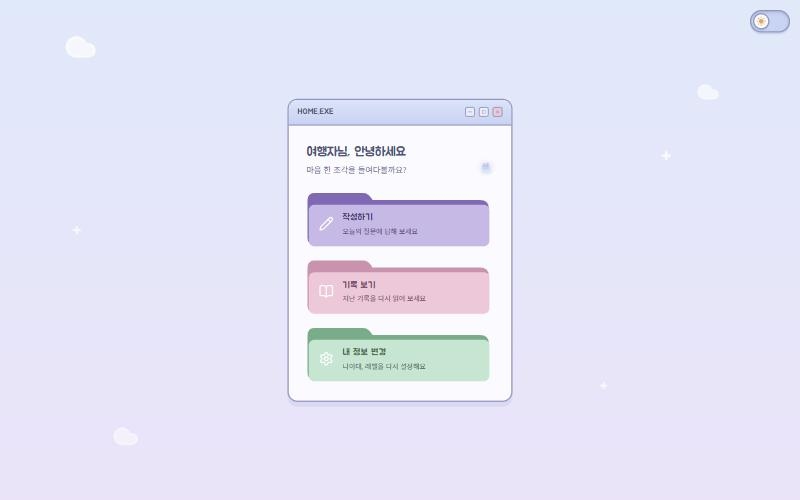
</p>

<br />

## 목차

- [기획 배경](#기획-배경)
- [타깃 사용자와 페르소나](#타깃-사용자와-페르소나)
- [스크린샷](#스크린샷)
- [서비스 흐름](#서비스-흐름)
- [핵심 기능](#핵심-기능)
- [디자인](#디자인)
- [기술 스택](#기술-스택)
- [시스템 구조](#시스템-구조)
- [데이터 모델](#데이터-모델)
- [프로젝트 구조](#프로젝트-구조)
- [로컬에서 실행하기](#로컬에서-실행하기)

<br />

## 기획 배경

### 문제

- 생각을 정리하고 싶어도 **무엇부터 써야 할지 막막합니다.**
- 일반 일기 서비스는 기록 기능에 집중되어 있어, **계속 쓰고 싶은 동기가 부족합니다.**
- AI 서비스는 답을 빠르게 주는 데 집중해서, **사용자가 스스로 생각하는 경험**을 주기 어렵습니다.

### 그래서 이렇게 풀었어요

| 문제                       | 해결                                                                      |
| -------------------------- | ------------------------------------------------------------------------- |
| 무엇을 써야 할지 모르겠다  | 나이대와 원하는 깊이에 맞춘 **질문 3개**를 받고, 그중 하나를 골라 답한다 |
| 쓰는 일이 부담스럽다       | 매일 쓰라고 재촉하지 않는다. 글자 수 제한도 없다                          |
| AI가 대신 답을 정해 버린다 | AI는 진단이나 조언 대신 **글에 드러난 마음을 비춰 주기만** 한다           |
| 기록이 딱딱하게 느껴진다   | 파스텔 레트로 데스크탑 감성의 포근한 UI로 기록 자체를 편안하게 만든다     |

<br />

## 타깃 사용자와 페르소나

**핵심 타깃**: 생각이 많고, 자신의 감정과 가치관, 일상을 글로 정리해 보고 싶은 사람

**사용 상황**: 잠들기 전, 퇴근 후, 혼자 있는 시간, 중요한 결정을 앞둔 때

**사용자 니즈**: 무엇을 쓸지 알려 주기 · 부담 없이 기록하기 · 내 생각을 다시 바라보기

### 페르소나

<table>
  <tr>
    <th width="33%">🌙 김서연 (27세, 직장인 3년 차)</th>
    <th width="33%">📚 박지후 (22세, 대학생)</th>
    <th width="33%">☕ 이정민 (36세, 이직을 고민 중인 개발자)</th>
  </tr>
  <tr>
    <td valign="top">
      <b>상황</b><br />
      퇴근하고 침대에 누우면 하루 동안 쌓인 생각이 많은데, 일기장을 펴면 막상 뭘 써야 할지 몰라 덮게 된다.<br /><br />
      <b>니즈</b><br />
      가볍게 하루를 돌아볼 수 있는 질문 하나<br /><br />
      <b>dear-mind에서는</b><br />
      Lv.1~2 질문으로 5분 안에 짧게 쓰고, AI가 짚어 주는 감정 키워드로 오늘의 기분을 확인한다
    </td>
    <td valign="top">
      <b>상황</b><br />
      진로와 인간관계 고민이 많지만 친구에게 털어놓기는 조심스럽다. 혼자 정리할 공간이 필요하다.<br /><br />
      <b>니즈</b><br />
      판단받지 않고 솔직하게 털어놓을 곳<br /><br />
      <b>dear-mind에서는</b><br />
      나만 볼 수 있는 기록에 생각을 적고, 평가 없이 마음을 비춰 주는 AI의 한마디를 받는다
    </td>
    <td valign="top">
      <b>상황</b><br />
      큰 결정을 앞두고 "나는 무엇을 중요하게 여기는가"를 정리해 보고 싶다. 상담까지는 필요 없다.<br /><br />
      <b>니즈</b><br />
      가치관을 깊이 들여다보게 하는 질문<br /><br />
      <b>dear-mind에서는</b><br />
      Lv.3~4 질문에 길게 답하고, 기록 보기에서 지난 생각이 어떻게 달라졌는지 돌아본다
    </td>
  </tr>
</table>

### 포지셔닝

> **AI 상담이 아닌, AI와 함께하는 자기성찰 기록 서비스**

AI는 진단, 치료, 상담을 하지 않습니다. 감정을 점수로 매기지 않고, 글에 드러난 표현을 있는 그대로 비춰 주는 역할만 맡습니다.

<br />

## 스크린샷

| 로그인                                     | 온보딩 (기본 레벨)                                          | 홈                                       |
| ------------------------------------------ | ----------------------------------------------------------- | ---------------------------------------- |
| 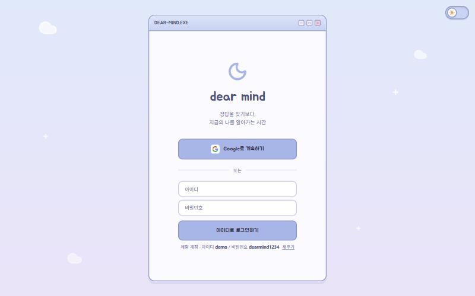      | 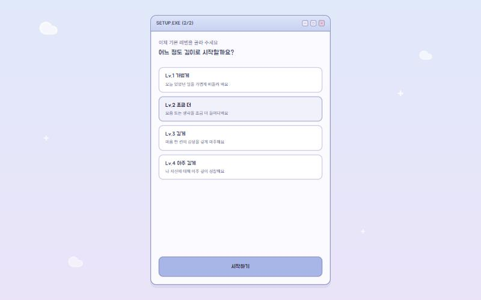            |          |
| **오늘의 질문**                            | **글쓰기**                                                  | **AI 분석**                              |
| 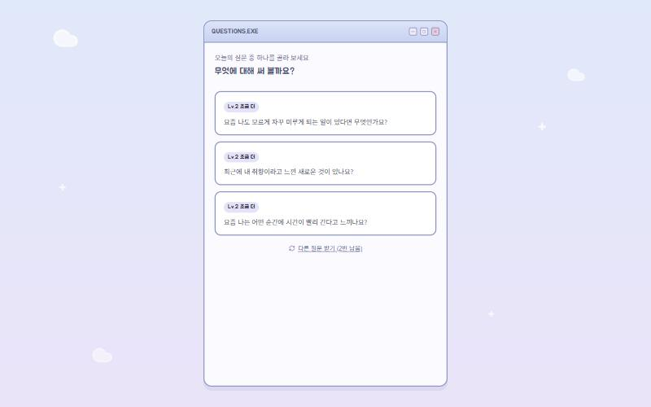 | 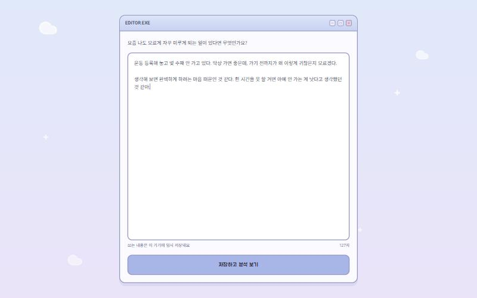                      | 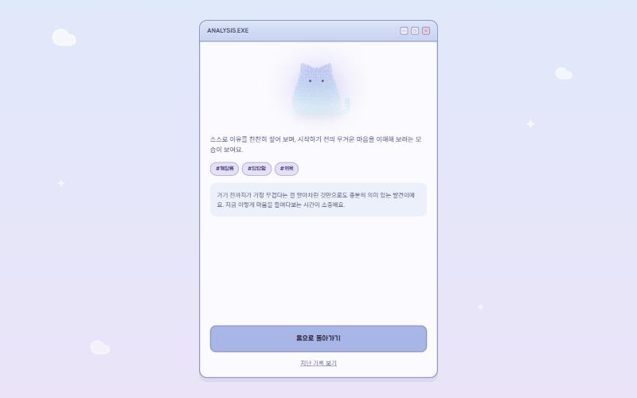 |
| **기록 보기 (목록)**                       | **기록 보기 (캘린더)**                                      | **다크 모드**                            |
| 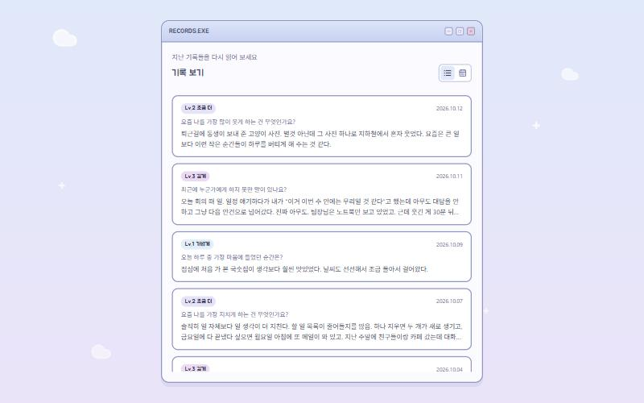 | 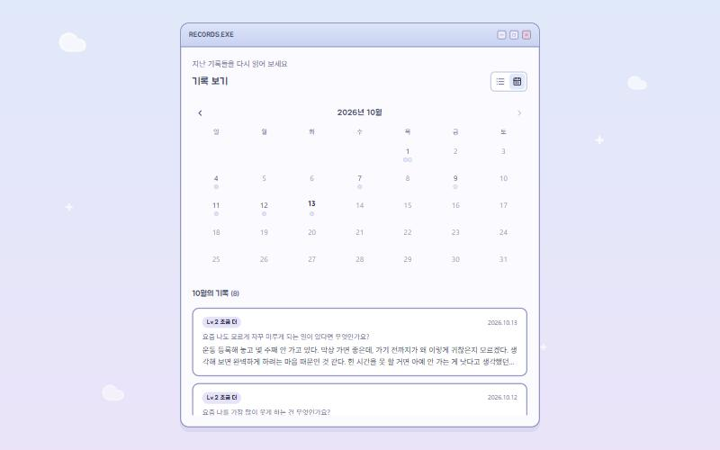       | 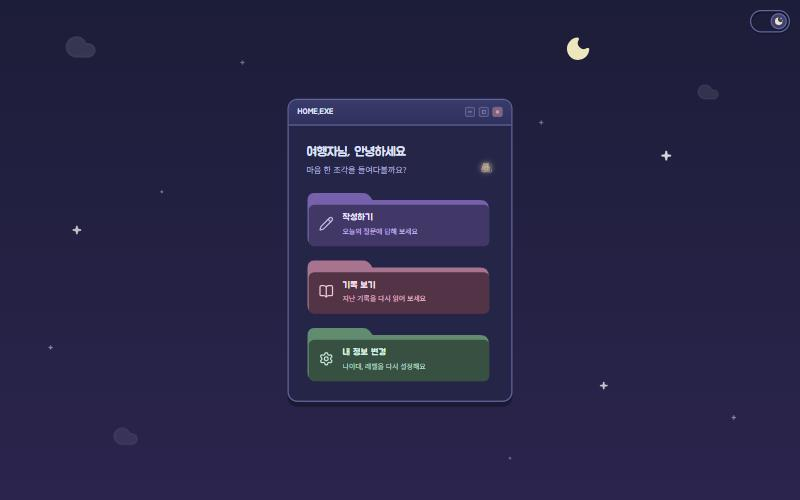  |

<br />

## 서비스 흐름

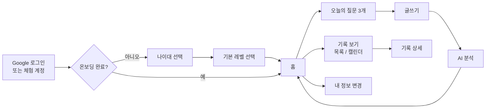

| 화면         | 경로                                   | 설명                                                        |
| ------------ | -------------------------------------- | ----------------------------------------------------------- |
| 로그인       | `/`                                    | Google OAuth 로그인 + 체험 계정용 아이디 로그인             |
| 온보딩       | `/onboarding/age`, `/onboarding/level` | 나이대와 기본 레벨 설정                                     |
| 홈           | `/home`                                | 폴더 모양 메뉴 3개 (작성하기 / 기록 보기 / 내 정보 변경)    |
| 오늘의 질문  | `/write`                               | 질문 3개 중 하나 선택, 다른 질문 받기, 레벨 변경 제안       |
| 글쓰기       | `/write/[id]`                          | 선택한 질문이 위에 고정된 집중형 에디터                     |
| AI 분석      | `/write/analysis/[journalId]`          | 요약 · 감정 키워드 · 한마디                                 |
| 기록         | `/records`, `/records/[id]`            | 목록 / 캘린더 보기, 상세에서 글과 AI 분석 다시 보기         |
| 내 정보 변경 | `/settings`                            | 나이대 · 기본 레벨 재설정, 로그아웃                         |

<br />

## 핵심 기능

### 1. 질문의 깊이, 레벨

생각의 무게감에 따라 질문을 4단계로 나눴습니다. 온보딩에서 평소 즐기는 깊이를 기본 레벨로 고릅니다.

| 레벨 | 이름      | 성격                                  | 색       |
| ---- | --------- | ------------------------------------- | -------- |
| Lv.1 | 가볍게    | 오늘 있었던 일을 가볍게 떠올려 봐요   | 하늘색   |
| Lv.2 | 조금 더   | 요즘 드는 생각을 조금 더 들여다봐요   | 라벤더   |
| Lv.3 | 깊게      | 마음 한 켠의 감정을 깊게 마주해요     | 핑크     |
| Lv.4 | 아주 깊게 | 나 자신에 대해 아주 깊이 성찰해요     | 진보라   |

Lv.1~2는 그날의 상황을 떠올리는 질문, Lv.3~4는 가치관이나 삶의 방향을 묻는 보편적인 질문이 자연스러워서, 이 기준을 질문 생성 프롬프트에 반영했습니다.

### 2. 오늘의 질문

- 사용자가 설정한 **기본 레벨(N)** 기준으로 질문 3개를 만듭니다.
  3개 중 **2개는 N**, 나머지 **1개는 N-1 / N / N+1 중 랜덤**이라 익숙한 깊이를 유지하면서도 가끔 다른 깊이의 질문을 만날 수 있습니다.
- 레벨 구성은 코드가 정하고, 각 레벨에 맞는 질문 문장은 **Claude가 나이대와 최근 받은 질문을 참고해** 새로 씁니다. LLM 호출이 실패하면 준비된 질문 은행에서 골라 질문 화면이 멈추지 않습니다.
- 받은 질문은 DB에 저장해 **같은 날 다시 들어와도 같은 질문**을 보여줍니다. (불필요한 LLM 호출 방지)
- **다른 질문 받기는 하루 2회**까지 가능하고, 오늘 받은 이전 세트는 `◀ ○ ○ ● ▶`로 넘겨 보며 어느 질문에든 답할 수 있습니다.
- "오늘"은 서버 시간대와 무관하게 **한국 시간(KST)** 기준으로 계산합니다.

### 3. 레벨 변경 제안

사용자가 설정한 레벨을 시스템이 임의로 바꾸지 않고, **선택 기록을 근거로 제안만** 합니다.

- 기본 레벨을 설정한 이후 쓴 최근 글 5개 중 **4개 이상이 기본 레벨보다 높은(또는 낮은) 질문**이면 질문 화면 위에 제안을 띄웁니다.
  > 요즘 더 깊은 질문을 자주 고르셨네요. 기본 레벨을 한 단계 올려 **Lv.3**으로 바꿀까요? `[바꾸기]` `[지금이 좋아요]`
- 수락하거나 거절하면 그 시점부터 다시 세어, 같은 제안이 반복해서 뜨지 않습니다.
- 자기성찰 서비스 특성상 더 깊은 질문으로 **자동 전환하는 것은 정서적으로 부담**이 될 수 있어 제안 방식을 택했습니다.

### 4. AI 분석

글을 저장하면 Claude가 Structured Output으로 아래 형태의 결과를 돌려주고, 글과 1:1로 저장됩니다.

```json
{
  "summary": "잘하고 싶은 마음이 커서 오히려 조급해졌던 것 같아요",
  "tone_keywords": ["조급함", "다짐", "기대"],
  "message": "천천히 생각을 정리해 가는 것만으로도 의미 있는 시간이에요"
}
```

- **summary**: 글을 다시 풀어 쓰지 않고, **글 밑에 깔린 마음을 짚는 짧은 알아차림**입니다. 짧은 글은 한 문장으로 씁니다.
- **tone_keywords**: 정해진 **감정 단어 40개 안에서만** 고르도록 스키마(enum)로 강제했습니다. "게으름"처럼 사람을 평가하는 꼬리표나 "우울"처럼 진단처럼 들리는 단어는 목록에 없습니다.
- **message**: 판단하지 않는 짧은 공감의 한마디입니다.

### 5. 안전 설계

- 자해나 위기를 암시하는 표현은 **두 단계**로 거릅니다.
  1. LLM 호출 전 **규칙 기반 필터**
  2. LLM이 함께 판단하는 `crisis` 필드
- 걸리면 AI 분석 대신 **전문기관 연락처가 담긴 고정 안내 문구**(자살예방상담전화 1393, 정신건강 위기상담전화 1577-0199)를 보여줍니다.
- AI는 진단이나 상담을 하지 않고, 감정을 확률이나 점수로 단정하지 않습니다.

### 6. 실패에 강한 AI 연동

- LLM 응답이 실패하거나 스키마에 맞지 않으면 **1회 재시도**합니다.
- 안전 분류기가 응답을 거절하면 **서버 측 폴백 모델**로 다시 시도합니다.
- 질문 생성이 실패하면 **질문 은행**으로 대체합니다.
- 분석에 실패해도 글은 이미 저장되어 있어서, 다시 분석하거나 기록 상세에서 이어서 분석할 수 있습니다.

### 7. 기록 보기

- **목록**: 질문과 답변 미리보기를 함께 보여줍니다.
- **캘린더**: 날짜 칸에 그날 쓴 글의 레벨 색 점(최대 3개)이 찍히고, 날짜를 누르면 그날 기록만 보여줍니다.
- 보기 방식, 달, 선택한 날짜는 URL(`?view=calendar&month=&date=`)에 남겨서, 상세 화면을 닫고 돌아와도 그대로 유지됩니다.

<br />

## 디자인

### 컨셉: 파스텔 레트로 데스크탑

기획 단계의 키워드는 **따뜻함 · 포근함 · 밤 · 기록 · 편지**였습니다. 이를 옛 Windows 데스크탑 감성으로 풀었습니다.

- 하늘색에서 라벤더로 이어지는 그라데이션 배경 위에 구름과 반짝임 장식
- 모든 화면을 `.EXE` 스타일 **창 프레임**(타이틀바 + 창 조작 버튼 3개)으로 구성
  - 기록 상세는 파일이라 `날짜.TXT`, 온보딩은 설치 프로그램처럼 `SETUP.EXE (1/2)`
- 홈 메뉴는 **폴더 아이콘** 모양 (작성하기 보라 / 기록 보기 핑크 / 내 정보 변경 민트)
- 레벨 1~4의 "가볍게 → 깊게"를 **하늘색 → 라벤더 → 핑크 → 진보라**로 표현
- 홈 인사말 옆 미니 고양이를 누르면 쓰다듬을 수 있는 작은 즐거움
- 라이트 / 다크 모드 전환

### UX 라이팅 원칙

- 해요체로 통일하고, 한 문장짜리 UI 문구는 마침표를 찍지 않습니다.
- 버튼은 누른 뒤 일어날 일을 드러냅니다. (예: `저장하고 분석 보기`)
- 에러 문구는 `[무엇]을 [하지] 못했어요. 잠시 후 다시 시도해 주세요` 형태로 통일합니다.
- "오늘도"처럼 **매일 쓰기를 강요하는 표현은 쓰지 않습니다.**

<br />

## 기술 스택

| 구분      | 사용 기술                                                            |
| --------- | -------------------------------------------------------------------- |
| Frontend  | Next.js 16 (App Router), React 19, TypeScript                        |
| Styling   | Tailwind CSS v4, lucide-react, Google Fonts (Jua)                    |
| Backend   | Next.js Server Components / Server Actions, Proxy (구 Middleware)    |
| DB / Auth | Supabase (PostgreSQL, Row Level Security, Google OAuth, 이메일·비밀번호 인증) |
| AI        | Claude Sonnet 5.5 (`@anthropic-ai/sdk`) + Structured Output (Zod)    |
| Deploy    | Vercel + Supabase                                                    |

### 이 스택을 고른 이유

- **Next.js + Supabase + Vercel**
  별도 백엔드 서버(NestJS 등), 자체 DB 운영, Docker/AWS 배포 대신 이 조합을 골라 인프라 부담을 줄였습니다. 그만큼 **프론트엔드 완성도와 AI 연동**에 시간을 더 썼습니다.
- **Server Components / Server Actions**
  API 키와 DB 접근을 서버에만 두고, 화면 데이터는 서버에서 바로 조회합니다. 클라이언트에는 꼭 필요한 상호작용 컴포넌트만 남겼습니다.
- **Supabase RLS**
  개인 기록을 다루는 서비스라, 애플리케이션 코드에 실수가 있어도 **DB 수준에서 본인 데이터만** 읽고 쓰도록 막았습니다.
- **Claude Sonnet + Structured Output**
  짧은 질문 쓰기와 글 요약이라 상위 모델과 품질 차이가 거의 없고, 응답이 빠르고(분석 약 3초) 비용이 낮습니다. 응답을 Zod 스키마로 받아 **프론트엔드에서 안정적으로 렌더링**합니다.

<br />

## 시스템 구조

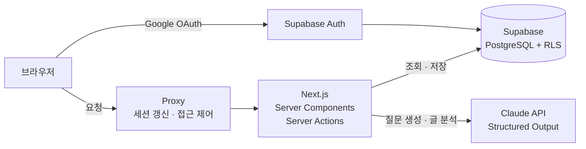

<br />

## 데이터 모델

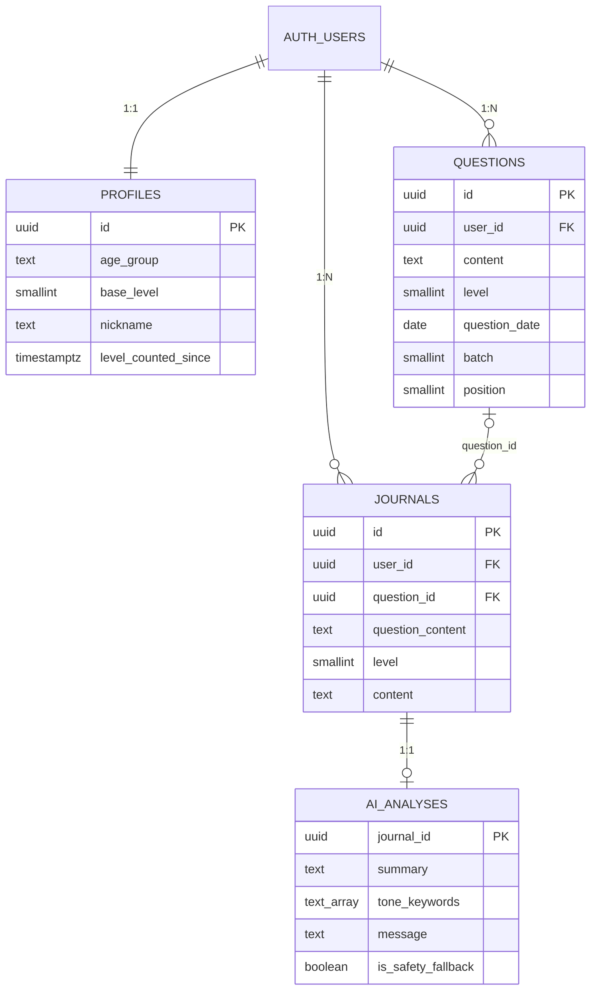

- **profiles**: 회원가입 시 DB 트리거로 자동 생성됩니다. `level_counted_since` 이후의 글만 레벨 변경 제안에 사용합니다.
- **questions**: `(user_id, question_date, batch, position)` unique 인덱스로, 동시에 요청이 들어와도 한 세트만 저장됩니다.
- **journals**: 질문이 삭제돼도 기록을 보여줄 수 있도록 질문 원문(`question_content`)을 함께 저장합니다.
- 모든 테이블에 **RLS**를 적용해 본인 데이터만 읽고 쓸 수 있습니다.

<br />

## 프로젝트 구조

```
app/
├─ page.tsx                  # 로그인
├─ auth/callback/            # OAuth 콜백 (온보딩 여부에 따라 분기)
├─ onboarding/               # 나이대 · 레벨 선택
├─ home/                     # 폴더형 메뉴, 미니 고양이
├─ write/                    # 오늘의 질문 · 글쓰기 · AI 분석
├─ records/                  # 기록 목록 · 캘린더 · 상세
├─ settings/                 # 내 정보 변경
├─ components/               # WindowFrame, FolderMenuItem, ThemeToggle 등 공통 UI
└─ lib/
   ├─ actions.ts             # Server Actions (저장 · 분석 · 새로고침 · 아이디 로그인)
   ├─ auth.ts                # 로그인 직후 이동할 경로 (온보딩 여부)
   ├─ demoAccount.ts         # 체험 계정 아이디 · 비밀번호
   ├─ db.ts                  # 조회 함수
   ├─ dailyQuestions.ts      # 오늘의 질문 세트 생성 · 조회
   ├─ levelSuggestion.ts     # 레벨 변경 제안 조건
   ├─ llm.ts                 # Claude 호출 (Structured Output, 1회 재시도, 폴백)
   ├─ questions.ts           # 질문 생성 (LLM + 질문 은행 폴백)
   ├─ analysis.ts            # 글 분석 · 위기 표현 필터
   ├─ emotions.ts            # 감정 키워드 단어 목록
   ├─ theme.ts               # 라이트 / 다크 테마
   └─ supabase/              # 서버 · 브라우저용 Supabase 클라이언트
proxy.ts                     # 세션 갱신, 비로그인 사용자 접근 제어
supabase/migrations/         # DB 스키마 · RLS 정책
scripts/seed-demo.mjs        # 체험 계정 생성 · 샘플 기록으로 초기화
```

<br />

## 로컬에서 실행하기

### 1. 환경 변수

프로젝트 루트에 `.env` 파일을 만들고 아래 값을 채웁니다.

```bash
NEXT_PUBLIC_SUPABASE_URL=
NEXT_PUBLIC_SUPABASE_PUBLISHABLE_KEY=
ANTHROPIC_API_KEY=
# 체험 계정 스크립트에만 필요 (서버 전용 키, 절대 공개하지 않음)
SUPABASE_SECRET_KEY=
```

### 2. DB 스키마

Supabase 프로젝트에 `supabase/migrations/`의 SQL을 순서대로 적용하고, Authentication에서 Google 로그인과 Email 로그인을 켭니다.

### 3. 실행

```bash
npm install
npm run dev
```

### 4. 체험 계정 (선택)

```bash
npm run seed:demo
```

체험 계정을 만들고 샘플 기록 10개를 넣습니다. 이미 있으면 비밀번호와 프로필을 되돌리고 기록을 샘플로 다시 채워서, 방문자가 남긴 글을 정리할 때도 같은 명령을 씁니다.

[http://localhost:3000](http://localhost:3000)에서 확인할 수 있습니다.
